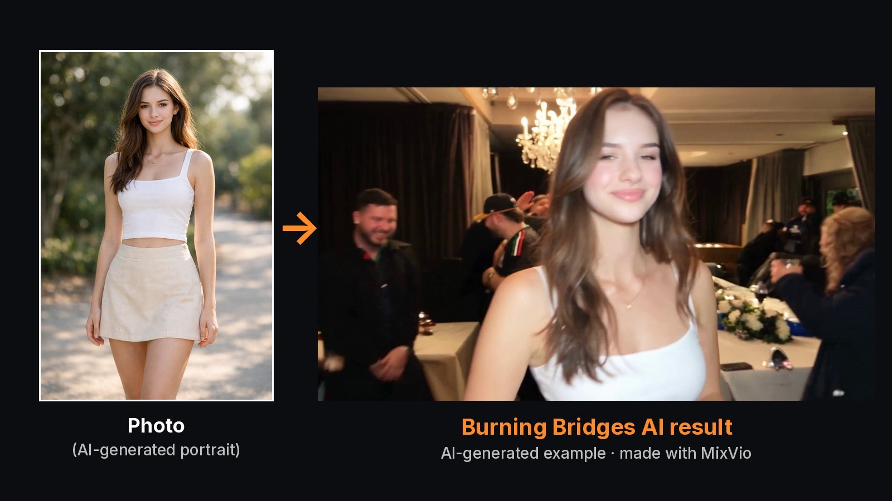

# Burning Bridges AI: test notes and photo template

Reusable notes from testing the Burning Bridges AI effect on MixVio: one photo in, a party clip out. Licensed CC BY 4.0.

Disclosure: Burning Bridges AI is a MixVio effect, which we build. Credit prices are a snapshot from 2026-10-11 and can change.

## Inputs

| Slot | Required | Notes |
|---|---|---|
| Lead photo | yes | one adult, face clear, upper body visible |
| Background 1-5 | no | one adult per photo, in order of appearance; empty keeps the source crowd |

No reference video and no prompt are needed.

## Output options

| Length | 480p | 720p | 1080p |
|---|---|---|---|
| 15 s | 180 | 375 | 660 |
| 29 s | 348 | 725 | 1276 |

Credits per video. Output is 16:9 only. 15 s is the closing segment; 29 s is the full party.
Default is 15 s at 720p (375 credits). Options live under Advanced settings.

## Photo checklist (copy per slot)

~~~
[ ] front-facing, both eyes visible
[ ] even light, no harsh shadows
[ ] no sunglasses, no heavy filter
[ ] single person, not cropped from a group shot
[ ] adult, and they agreed to be in the video
~~~

## Observations from our test run

- Face, hair, top and necklace carried over closely from the input.
- Hands and small clothing details vary between runs; re-run instead of editing.
- The audio is the original source track attached after the visual edit, not regenerated.
  Our 15 s output matched the last 15 s of the original preview track (correlation 0.993).
- "Restore original sound" re-attaches the track without spending generation credits.
- Source clips can include brand logos on jerseys; avoid picking those frames as thumbnails.

## Link

Effect page: [Burning Bridges AI on MixVio](https://mixvio.ai/ai-effects/burning-bridges-ai?utm_source=github&utm_medium=notes&utm_campaign=burning-bridges&utm_content=test-notes#effect-workspace)

The effect is not affiliated with Drake.
