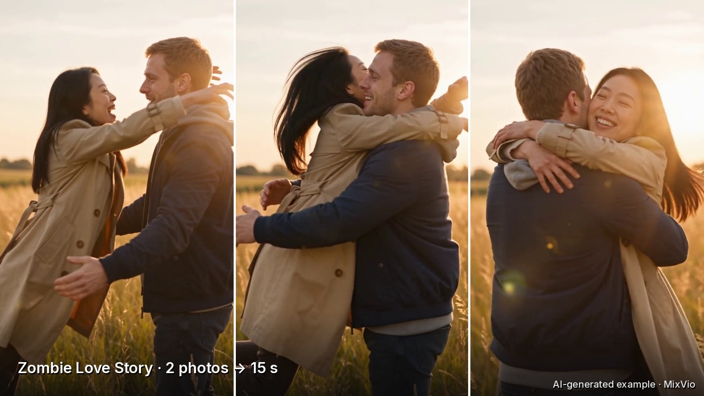
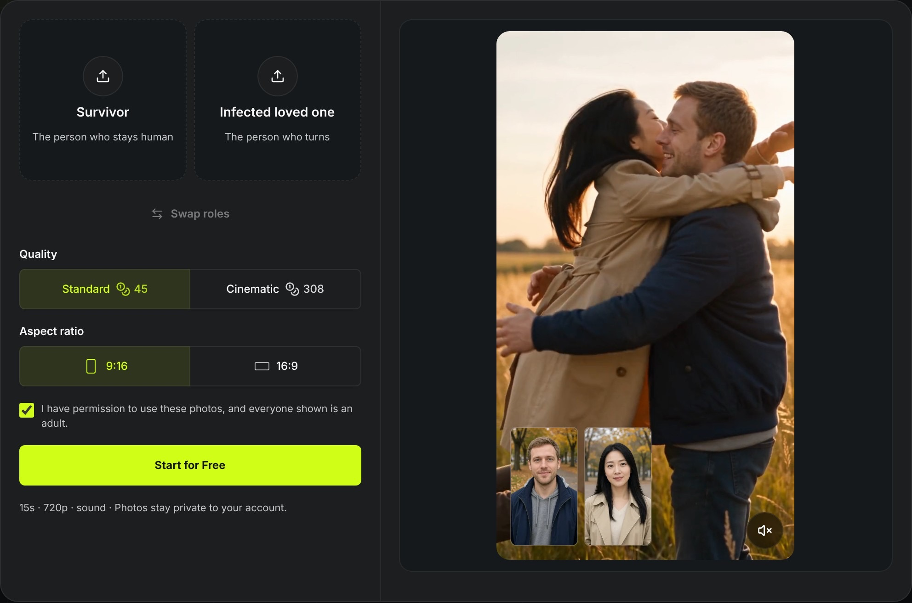

# Halloween zombie effects: test notes

Notes from MixVio's two Halloween effects, AI Zombie and Zombie Love Story. Licensed CC BY 4.0.

Disclosure: both are MixVio effects, which we build. Prices are a snapshot from 2026-10-12 and can change.

Content note: AI Zombie outputs show blood-streak makeup and end in a scream. The Zombie Love Story template shows a handgun being aimed and dropped and a zombie lunge before a twist cut to a hug.

## Side by side

| | AI Zombie | Zombie Love Story |
|---|---|---|
| Photos | 1 | 2 (Survivor + Infected loved one, swappable) |
| Length | 5 s | 15 s |
| Resolution | 720p | 720p |
| Aspect ratio | follows the photo | 9:16 or 16:9 |
| Sound | yes | yes |
| Credits | 21 | 45 Standard, 308 Cinematic |
| Prompt | none | none |

## Story beats (Zombie Love Story)

| Time | Beat | What happens |
|---|---|---|
| 0-5 s | Standoff | survivor aims a handgun at the loved one who turned |
| 5-10 s | Choice | gun dropped, arms open, zombie lunges |
| 10-15 s | Twist | match cut mid-leap to a hug in a sunny memory |

## Photo checklist

~~~
[ ] one adult per photo, and they agreed
[ ] facing the camera, eyes visible
[ ] chest-up framing
[ ] even light; similar light in both photos for the couple version
[ ] no sunglasses, no heavy filter, not cropped from a group shot
~~~

## Thumbnail and caption rules we use

- AI Zombie: thumbnail from the first frame (about 0.2 s), before the change starts.
- Zombie Love Story: thumbnail from after 10.5 s, when the gun is gone and the hug begins.
- Caption: one-line content note, plus "AI-generated".
- Pinterest and email: use the gun-free cut only.

## Links

- [AI Zombie on MixVio](https://mixvio.ai/ai-effects/ai-zombie?utm_source=github&utm_medium=notes&utm_campaign=halloween-zombie&utm_content=test-notes-ai-zombie#effect-workspace)
- [Zombie Love Story on MixVio](https://mixvio.ai/ai-effects/zombie-love-story?utm_source=github&utm_medium=notes&utm_campaign=halloween-zombie&utm_content=test-notes-zls#effect-workspace)
