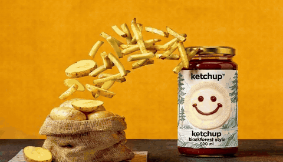
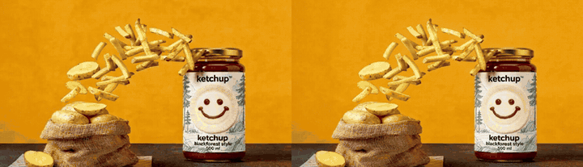
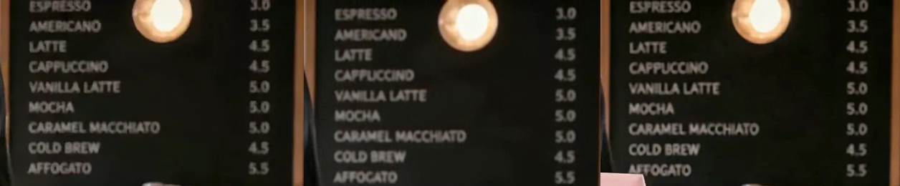
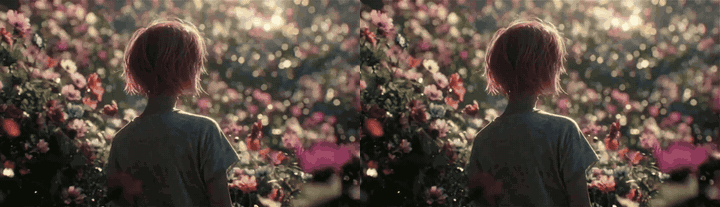
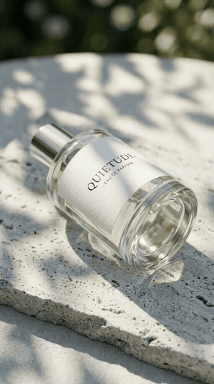
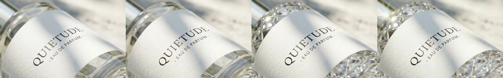
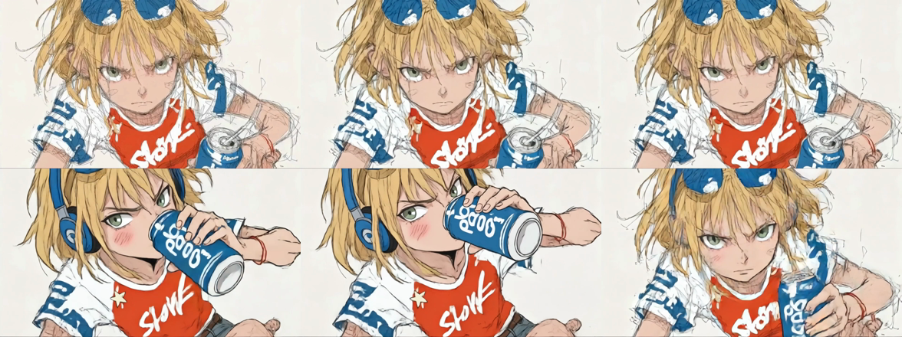

# Image to video: 14 runs, 5 models, 386 credits

Field notes from one test session on 2026-10-08. Six still images, 14 image-to-video generations, every credit and every failure logged.

- **Raw results:** [`runs.csv`](runs.csv) has each run's model, settings, exact prompt, price, wait time, output size and verdict.
- **Prompt templates:** [`prompt-templates.md`](prompt-templates.md).
- **Long-form write-up:** [What 14 test clips taught me about turning photos into video](https://medium.com/@MixVioAI/image-to-video-ai-what-14-test-clips-taught-me-about-turning-photos-into-video-d18e8297110a) on Medium.

> **Disclosure.** These notes are maintained by the MixVio team, and every run was made on [MixVio AI](https://mixvio.ai/?utm_source=github&utm_medium=readme&utm_campaign=i2v_guide_2026q4&utm_content=brand_link). We did not repeat the test on other platforms, so this is not a platform comparison. All clips and stills below are AI-generated. The text was edited with help from an AI writing assistant; the numbers come from the test log.

## Results at a glance

| Shot | Runs | Usable | What decided it |
| --- | --- | --- | --- |
| Ketchup jar, product motion | 3 | 1 | The motion-only prompt worked; the scene-style prompt and Kling 3.0's hover loop did not |
| Studio portrait | 2 | 2 | Both usable; Kling 3.0 held the face best |
| Back view, head turn | 2 | 1 | Veo 3.1 Fast turned the wrong way |
| Cafe creator with a spoken line | 2 | 1 (+1 picture only) | MiniMax H3 added garbled words before the line |
| Loose pencil sketch | 3 | 0 | Every model lost the pencil texture |
| Perfume bottle, start + end frame | 2 | 2 | The most predictable mode in the test |

**Cost:** 386 credits for 14 clips, 7 usable, so about **55 credits per usable clip** against an average of about 28 credits per run. On a $10-for-200-credits plan that is roughly $19 for the session. Four of the five models were discounted that day (MiniMax H3 was not); at list prices the same 14 runs would have cost 750 credits. Both prices are in `runs.csv`.

**Wait:** Kling 3.0, MiniMax H3 and Veo 3.1 Fast finished in about 1.5–2 minutes. Seedance 2.0 took 3.5–7.5 minutes.

## Five findings

### 1. Describe the motion, not the picture

Same photo, same model (Seedance 2.0), same price. The left clip used a motion-only prompt; the right one described the scene like an image prompt.

The scene prompt did not produce a calmer clip. The model filled the gap itself: whole potatoes launched out of the sack, a sparkle effect appeared, the camera rose, and a surface that is not in the photo appeared under the jar. The structure that worked:

> **Subject action + environment motion + camera + what must stay the same**

The last part mattered most. "Keep the jar label sharp and unchanged" held in all three ketchup runs, and "keep the menu board unchanged" kept all nine prices in both cafe runs.

### 2. Camera instructions are the least reliable part of a prompt

- Seedance 2.0 turned "slow push-in" into a hard push that ended on a close-up of the label.
- Kling 3.0 ignored the push-in completely.
- "Locked-off camera" and "camera stays still" still drifted on Seedance 2.0.

If the frame must not move, plan to stabilize in an editor. Direction words are ambiguous too: asked to turn "to the left over her shoulder", Seedance 2.0 Mini turned to her left and Veo 3.1 Fast turned the other way. Write "screen left" or "screen right".

### 3. Start and end frames remove most of the guessing

With a plain glass bottle as the start frame and the same bottle in cut crystal as the end frame, both models delivered. MiniMax H3 (15 credits, about 1.5 minutes) kept the QUIETUDE label crisp through the change. Seedance 2.0 got there too, but softer at 480p.

Use it for before/after reveals, packaging changes and shots that must cut cleanly into the next one. Not every model accepts an end frame; Veo 3.1 Fast took a single image in this setup.

### 4. Some images should stay still

The loose pencil sketch failed three times (86 credits). Seedance 2.0 Mini redrew it as clean cel animation. Kling 3.0 cut to a new angle after about two seconds and swapped the goggles for headphones. The retry with "Continuous single shot, no cuts" removed the cut, but the pencil texture was gone within a second.

If the texture or an exact detail is the value of the image, do not animate it.

### 5. Check every spoken word

Seedance 2.0 said the scripted line exactly. MiniMax H3 added a garbled phrase before it and slurred "gummy". The picture was fine, and the error only showed up in a transcript. Transcribe or listen with headphones before posting, or mute and caption.

## Checklist before you spend credits

1. One clear subject with room around it; large printed text if text matters.
2. Pick the aspect ratio yourself. Auto reframed a 16:10 photo to about 16:9.
3. One or two actions per 5-second clip.
4. End every prompt with what must not change.
5. Use start and end frames when you know where the shot has to land.
6. Render text-heavy shots at 720p or above.
7. Run the same frame through two models before deciding.
8. Have rights to the image and consent from any real person, and label realistic AI content where platforms require it (for example, [YouTube's disclosure rules](https://support.google.com/youtube/answer/14328491)).

Runway's [image to video prompting guide](https://help.runwayml.com/hc/en-us/articles/48324313115155-Image-to-Video-Prompting-Guide) makes a related point about working with, not against, the motion already implied in a photo.

## How the test was run

- **Date:** 2026-10-08. Prices and model behavior change; treat these numbers as a dated snapshot.
- **Where:** [MixVio's image to video tool](https://mixvio.ai/tools/image-to-video?utm_source=github&utm_medium=readme&utm_campaign=i2v_guide_2026q4&utm_content=i2v_link), one account, one job at a time.
- **Models:** Seedance 2.0, Seedance 2.0 Mini, Kling 3.0, MiniMax H3, Veo 3.1 Fast, at each model's default duration (5 s; Veo 3.1 Fast 6 s) unless noted in `runs.csv`.
- **Inputs:** six AI-generated, MixVio-owned showcase images of fictional people and products.
- **Review:** every clip was reviewed as frame strips and contact sheets; speech was transcribed locally with Whisper.
- **Failures:** no run failed on the model side, so the session could not test refund behavior for failed generations.
- **Not tested:** other platforms, longer clips, higher resolutions on every model, or repeat runs to measure variance. Each verdict is one run.

## Files

| File | Contents |
| --- | --- |
| [`runs.csv`](runs.csv) | All 14 runs with prompts, credits, wait times and notes |
| [`prompt-templates.md`](prompt-templates.md) | Reusable templates and the exact prompts tested |
| [`media/`](media/) | Compressed GIFs and frame comparisons from the runs |

*By Alex Wang, MixVio AI. Text, data and media are licensed under [CC BY 4.0](../LICENSE).*
